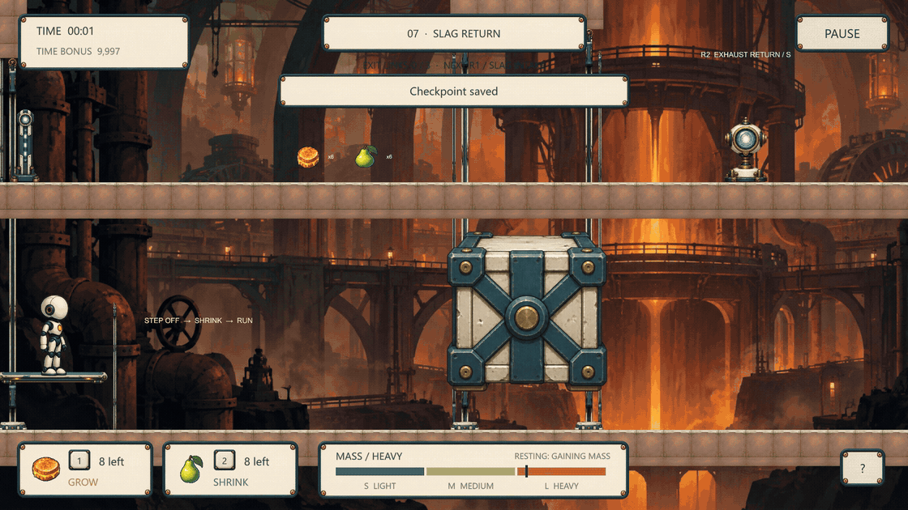
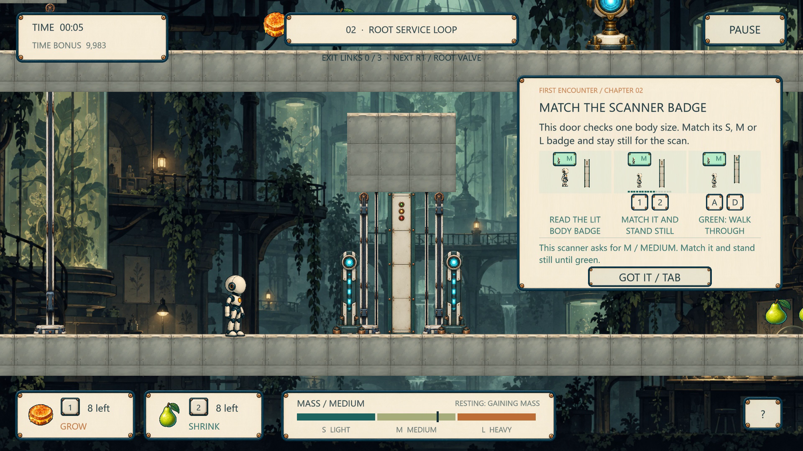

# Design iteration — restore the consequence, explain the purpose

[Project home](../README.md) · [Concrete level cases](Level-design.md) · [Full visual portfolio](../portfolio/Full-case-study.md#page-09)

These revisions come from author walkthroughs and recorded implementation regressions during development. They are not results from a recruited external player study.

## Counterweight: a missing consequence

**Intended decision:** open the stone with heavy weight, then leave, shrink and cross while it closes. The lower-left return path makes a failed timing attempt resettable.

| Earlier implementation | Problem observed | Revision | Current player experience |
| --- | --- | --- | --- |
| Leaving the plate started an eight-second hold before return motion. | The stone appeared to remain suspended without anyone pressing the plate. The immediate relationship between leaving and closure was missing. | Remove the empty-plate hold. Re-evaluate rider state every physics tick, retaining medium's balance state. | Leaving immediately starts plate rise and stone descent. The player can see the available opening closing, shrink to cross, or return left and reopen it. |

**Historical code excerpt — archived development revision `3d593ab`:**

```csharp
// Earlier implementation; not the current game.
if (rider)
    returnAfter = Time.time + 8;
else if (Time.time < returnAfter)
    return;
```

This excerpt was verified against the local development history. It is textual evidence of the previous behavior, not a reconstructed gameplay screenshot. The first source commit on this public branch preserves the current implementation; this archived local development revision is not presented as a public branch or release.

**Current implementation — [`PlatformAndRockController.FixedUpdate()`](../Assets/Script/LevelTwo/PlatformAndRockController.cs):**

```csharp
bool lower = rider && rider.Size == 2;
if (rider && rider.Size == 1)
    return;
// Move towards heavy/open or empty/light/return every physics tick.
```

[](../portfolio/media/counterweight-crossing.gif)

*Current chapter 07 recording. The left plate and right stone reverse during the same continuous take. Different authored chapters can use different travel distances and speeds; no universal crossing time is claimed.*

Historical checks included a successful timed crossing, an intentionally late blocked attempt and retreat left after closure. They establish the specific mechanism consequence. They do not establish that an unfamiliar player will notice the reset route without help.

## Guidance: an action label is not an explanation

Author review found three distinct gaps: a pad did not explain its interaction key; a completed device did not explain which gate it powered; an exit checklist did not explain what its count represented.

| Before | Changed design | Current implementation |
| --- | --- | --- |
| Large early explanations exposed unrelated future climate rules. | Teach basic movement in context; introduce heat in the Foundry and cold in the Observatory. | Region-triggered guidance; the region also changes the actual metabolism rates. |
| A label such as “record a heavy echo” did not explain why. | Explain purpose, action and linked destination together. | Heavy + **E** records a temporary load; the illustrated lesson shows shrinking to pass its marked gate. |
| A local hint could vanish when its proximity point was passed. | Separate readable exposure and explicit acknowledgement from action completion. | Cards remain after the trigger, require readable time, and confirmed lessons do not repeat. Compact rooms page their diagrams rather than stretching them. |
| Unexplained exit counts and remote locks encouraged aimless searching. | Introduce whole-level circuits once; keep individual device teaching local. | Shared R/E/P/D identifiers, named missing prerequisites, first circuit/optics overviews and source-specific device lessons. |

[](../portfolio/media/first-encounter.png)

*Chapter 02: the real scanner is still visible left of the card. Read the three body/key/action diagrams rather than a list of all future mechanisms.*

[`FirstEncounterGuide`](../Assets/Script/FirstEncounterGuide.cs) stores acknowledgement separately from prior action flags. Its placement checks compare the player's feet with the device landing so a lower-floor pass does not introduce an upstairs machine.

The existing v2.4.0 records report **61 integration checks, 238 placement checks and 13 paging checks**. Twelve input-driven routes produced **753 visible guidance samples**, with no sampled actor/device overlaps. These are scoped regression results, not proof of universal readability or first-time understanding. [Machine-readable scope](Release-2.4.0.json).

## Camera comfort: stop means stop

The previous camera smoothed a directional look-ahead target and then smoothed toward it again. When input stopped, the camera still moved forward before returning. Author feedback described the lurch as uncomfortable.

The revised [`CameraFollow.LateUpdate()`](../Assets/Script/CameraFollow.cs) has a horizontal dead zone, no stored horizontal camera velocity and no automatic horizontal recentering. Short taps inside the zone do not move the room. Vertical framing uses the character's feet so a body change does not lift the entire background.

This is a comfort decision tied to precise platforming: the player should judge the landing and obstacle against a stable room after releasing input. The existing regression exercised stop, tap, reversal, jump and landing phases at target 30/60/120 fps and different body sizes. Twenty-five stop intervals passed the stationary-camera condition. These target settings do not claim identical timing on every hardware/display combination.

## Retry design: preserve a solved relationship

Earlier review found checkpoints in insufficient clearance and retries that could strand the player beyond an unpowered prerequisite. The current beacon requires a supported area clear for at least a medium body, even if touched while small. The restored body is validated again after loading.

[`CampaignCheckpointState`](../Assets/Script/CampaignCheckpointState.cs) saves completed relays, receiver charge and rail travel/dock flags alongside the player's inventory snapshot. Temporary echoes and bridge energy remain temporary. The player repeats the failed execution rather than losing the logical work already recorded at the checkpoint.

## What still needs validation

These revisions are implemented and supported by author observations, source inspection and existing scripted regressions. A new external first-time playtest is still needed to evaluate comprehension, perceived difficulty and enjoyment across the full fifteen-chapter campaign. No success-rate, retention or usability-improvement percentage is asserted.
