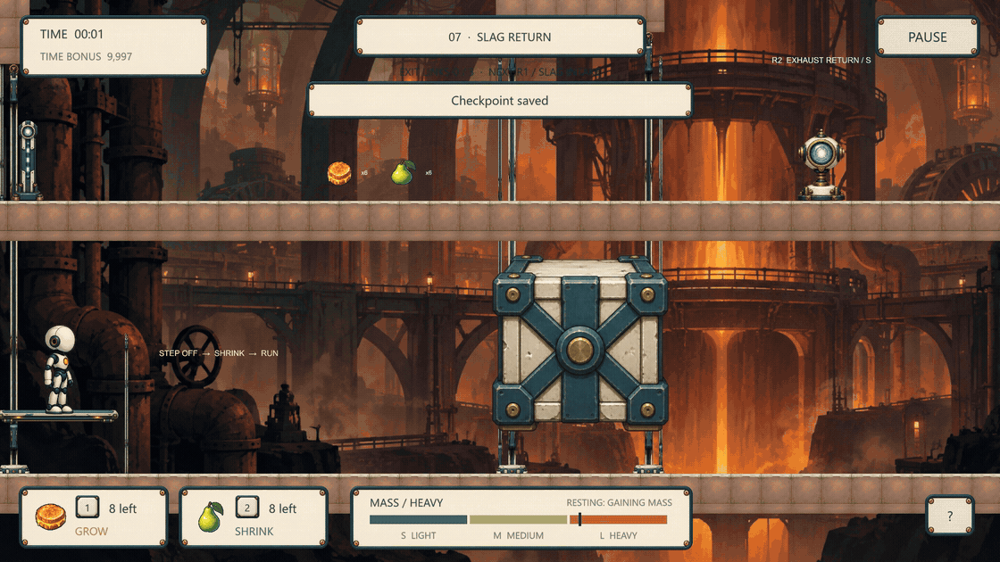
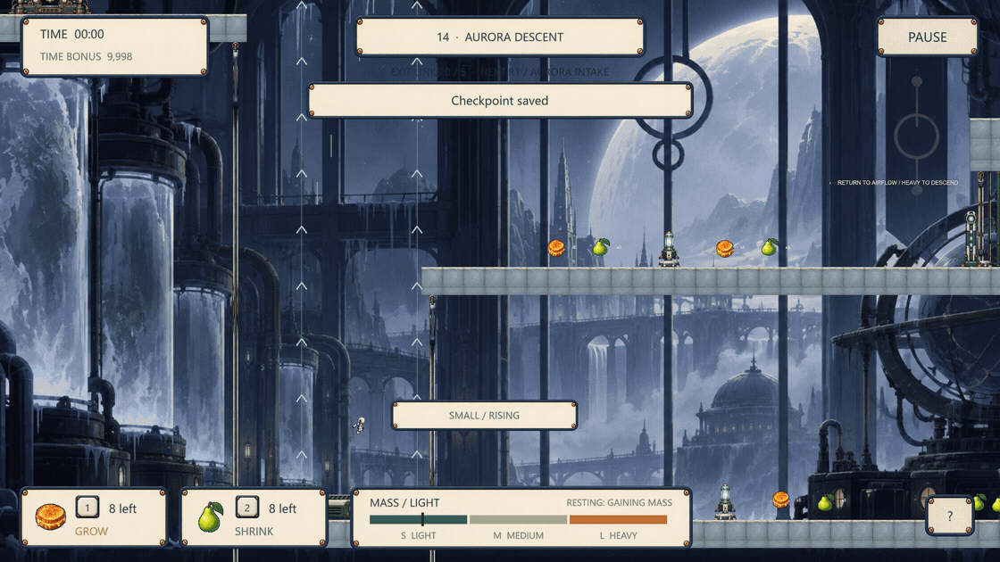
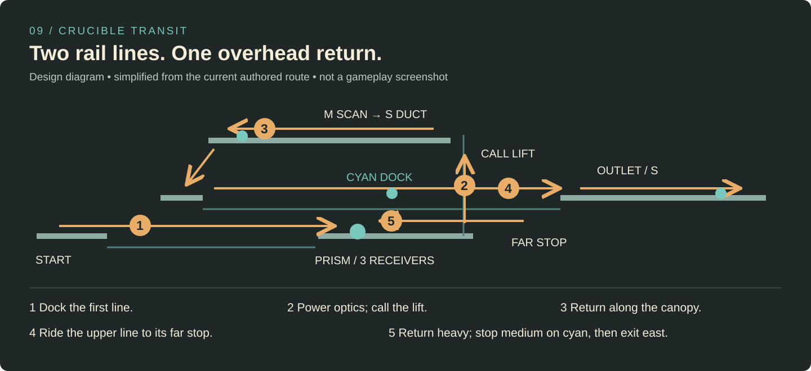
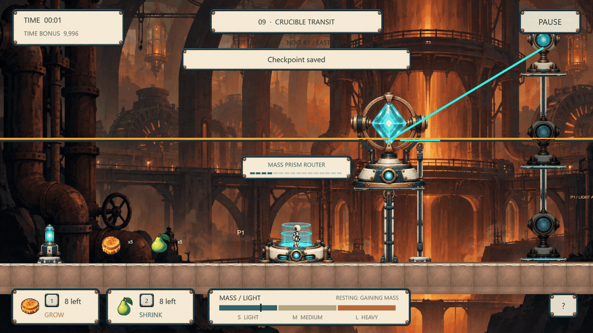
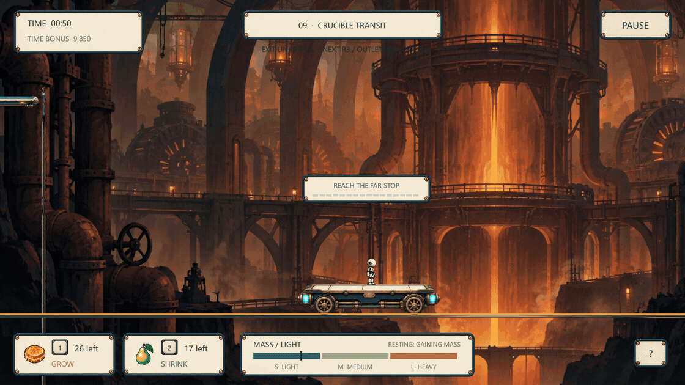

# Level design — body, route and consequence

[Project home](../README.md) · [Complete visual portfolio](../portfolio/Full-case-study.md) · [Source guide](Code-guide.md)

**Current implementation: v2.4.0. All levels designed by Yibo Wang.** The cases below describe the playable campaign, rather than proposed levels. The route drawing is an explanatory diagram; the GIFs are actual Unity recordings.

## Slag Return

**Chapter 07 · Foundry · A timed commitment with a reset route**

*Read left to right: lowering plate → rising stone → body change → crossing. The closing motion begins on leaving the plate, not after a hidden grace period.*

| Design question | Current arrangement and player consequence |
| --- | --- |
| Can I understand the cause before committing? | Plate and stone share the first view. Moving the plate reveals the stone's opposite motion. |
| Why change after opening the route? | Heavy holds the opening but moves slowly. Small gives clearance and speed while the stone closes. Medium can hold an intermediate height while aboard. |
| What does a failed attempt teach? | The descending stone visibly consumes the opening. A deliberately late recorded attempt is blocked; retreat left remains possible. |
| How do I recover? | The lower return approach leads back to the plate and food. The mechanism reverses again under a heavy rider. It is not a one-shot puzzle. |
| What comes after the dash? | A light route relay, a heavy scanner and freight ascent lead to an upper westward exhaust route. The route ends west of the starting approach rather than continuing as another straight corridor. |

The physical arrangement is authored in [`SlagReturn()`](../Assets/Script/RegionalRoutes.cs), and the continuous machine response lives in [`PlatformAndRockController.FixedUpdate()`](../Assets/Script/LevelTwo/PlatformAndRockController.cs). Food is placed before commitment; the mass HUD lets the player see movement and rest changing the next body state.

The GIF shows a successful crossing from a prepared recording state. The historical regression separately checked an intentionally late block and retreat left; that evidence does not claim a complete unaided traversal of the whole reset loop. [See the actual revision](Design-iteration.md#counterweight-a-missing-consequence).

## Aurora Descent

**Chapter 14 · Frozen Observatory · Separate ascent, braking and descent**

*This real-time excerpt starts below the middle port. The same free-flight field can be approached from above during the full route. It is distinct from the tiered ascent shaft.*

The western tiered fan leads to a high intake. From there the player reaches a separate free-flight shaft. Its middle port opens onto a medium scanner and a medium route relay; the lower branch requires a heavy relay, then a spring tower leads to a high return crossing.

1. **Observe:** the middle landing is beside the field, not at its top. Rising as small alone will not solve it.
2. **Judge:** use medium to remove vertical travel at the port's height, then steer sideways. If approaching from above, use heavy to descend before braking.
3. **Act:** change body inside the field. There is no separate flight-control inventory or new movement key.
4. **Read the result:** the visible body, height and landing show whether the brake was early or late. The scanner and relay reinforce the need for medium on that branch.
5. **Recover:** the lower floor and supplies offer another ascent if the port is missed. The subsequent low route and eastern tower give the return journey a different task.

**Why two airflow modes?** Tiered airflow teaches size-to-destination mapping. Free airflow then asks the player to decide *when* to stop changing altitude. The same three states become a more precise spatial tool.

[`AuroraDescent()`](../Assets/Script/RegionalRoutes.cs) places the separate shafts and side landing. [`VectorAirwell.FixedUpdate()`](../Assets/Script/VectorAirwell.cs) distinguishes convergence to authored landing tiers from free rise/hold/descent. The player continues to use normal horizontal movement.

## Crucible Transit

**Chapter 09 · Foundry · A dependency route with two different rail journeys**

*Simplified from `CrucibleTransit()`; arrows show the required route, not a proposed shortcut. The second line is higher than the first, and the overhead path moves back west.*

| Beat | What is arranged | Decision and observable result |
| --- | --- | --- |
| Lower outward line | First carriage, cyan dock, eastern landing | Small travels east; medium must stop on the dock to store the first rail link. |
| Optical dependency | Prism with three receivers and a visible P1 connection to the lift call | Cycle the three body sizes until every receiver is charged. The lift indicator changes to ready. |
| Freight ascent | Heavy pressure call; lift arrives from above | Heavy brings it down; become small to move and board before riding up. |
| Overhead return | Medium scanner, low duct and west-side descent | Stabilize at medium for the scan, then become small for the duct. The former background deck becomes the playable return route. |
| Second line | Far-stop requirement followed by a return dock | Small reaches the far terminal; heavy initiates the return; medium stops at cyan. A first outward stop alone is insufficient. |
| Outlet | Small passage and route regulator | Complete the remaining route links, then take the eastern exit. The exit names an outstanding requirement if anything is missing. |

*The cut removes the short travel between devices. Watch all receiver lights become green before the heavy body calls the lift.*

*The two excerpts omit the middle of the rail journey. The far-stop, reversal and dock feedback are actual game states, not editorial labels.*

This layout combines **clearance, body-controlled transport and circuit dependencies**. Difficulty comes from reading where a completed action lets the player go next. Completed relays, optical charges and required docks are captured at checkpoints, so a later fall need not erase already solved prerequisites. Temporary echoes and bridge energy remain temporary.

Relevant implementation: [`CrucibleTransit()`](../Assets/Script/RegionalRoutes.cs) → [`OpticalLiftPower.Connect()`](../Assets/Script/OpticalLiftPower.cs) → [`RailShuttle.FixedUpdate()`](../Assets/Script/RailShuttle.cs) → [`RouteCircuit.Complete`](../Assets/Script/RouteCircuit.cs) → [`CampaignCheckpointState.Capture/Restore()`](../Assets/Script/CampaignCheckpointState.cs).

## Campaign progression

Each region contains five consecutive chapters. Chapter identity and climate are explicit; they are not selected by cycling greenhouse/foundry/ice after every level. [`CampaignMap`](../Assets/Script/CampaignMap.cs) defines order; [`CampaignExpansion.Build()`](../Assets/Script/CampaignExpansion.cs) selects the twelve individually authored later routes.

| Chapter | Route structure | Design focus |
| --- | --- | --- |
| 01 · The Greenhouse | Authored introductory ducts and pressure lift | Establish body, clearance and food. |
| 02 · Root Service Loop | Low eastbound service lane; upper westbound canopy | Introduce return routing and scanner preparation. |
| 03 · Canopy Junction | Central shaft with low, middle and high branches | Size selects a destination; all branches matter. |
| 04 · Pollination Circuit | East rail; upper west return; exit west of entry | Store a dock, then use a heavy echo to pass small. |
| 05 · Biodome Lockdown | Three-storey irrigation, ventilation and canopy route | Combine earlier greenhouse tasks before the impact bridge. |
| 06 · Thermal Core | Authored counterweight and mass-lift foundation | Introduce heat's changed gain/loss rhythm. |
| 07 · Slag Return | Closing-stone dash; upper exhaust return | Commit, shrink, cross; recover and reset if late. |
| 08 · Furnace Exchange | Staggered lifts, coolant descents, high exchanger return | Prepare platform heights and later resource needs. |
| 09 · Crucible Transit | Two rail elevations with an optical overhead bypass | Power the ascent, return through space, satisfy a return dock. |
| 10 · Reactor Shutdown | Service circuit, cooling ascent, reactor crown, side vent | Combine interlocks with controlled free-flight descent. |
| 11 · Frozen Observatory | Authored spring and balance foundation | Introduce cold's faster movement loss and slower rest gain. |
| 12 · Ice Spiral | Right-left-right spring shelves; outside stair descent | Prepare a landing state separately from a launch state. |
| 13 · Glacier Balance | Paired chasms, low far approach, high return | Read reversed counterweight sides and plan both approaches. |
| 14 · Aurora Descent | Separate rise/descend shafts, middle brake port, far tower | Control trajectory with size, then return at a different elevation. |
| 15 · Last Light | Spring, balance, rail, optical crown, airflow and final bridge | Combine regional learning across five linked sectors. |

The three region-opening maps retain their authored layouts. The later maps were rebuilt after author review found repeated route structures and an alternating-region campaign. Increasing challenge is an authored progression goal, supported by distinct route geometry and input-driven completion records; it is not a measured claim about first-time player enjoyment or completion times.

## Evidence and boundaries

- The release record covers the current fifteen-chapter build and twelve input-driven route regressions with first-encounter explanations enabled.
- Placement and clearance probes are separate from full route regressions. A probe that positions the actor is not counted as a playthrough.
- The public film excerpts rehearse particular decisions in isolated recording states. They demonstrate current mechanics, not external user-test success rates.
- No unfinished feature or proposed chapter is presented here as implemented. External first-time comprehension and enjoyment testing remains future validation.

[Verification summary](Release-2.4.0.json) · [Iteration history](Design-iteration.md) · [Full visual case study](../portfolio/Full-case-study.md)
