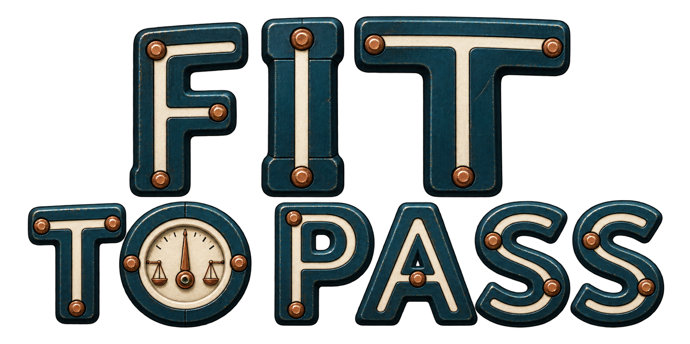
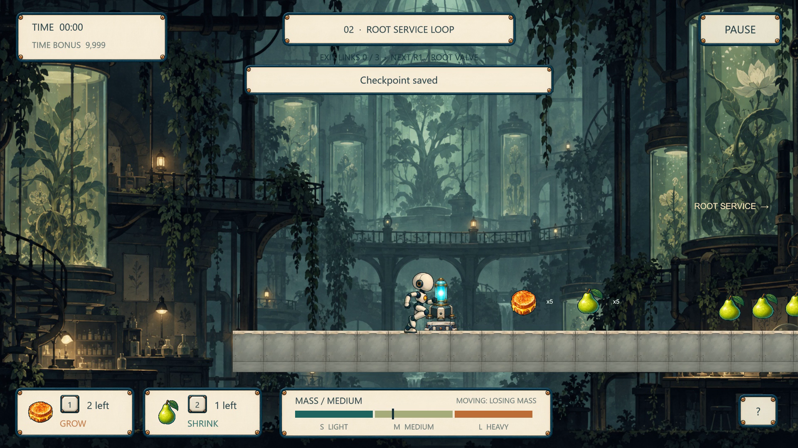
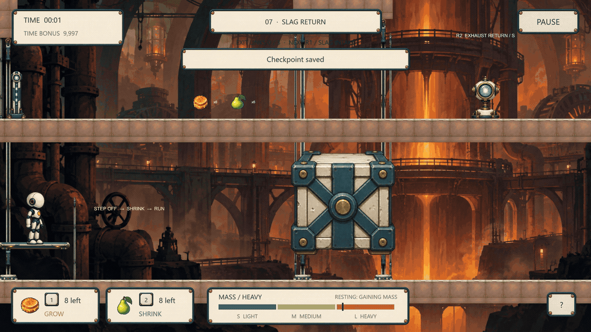
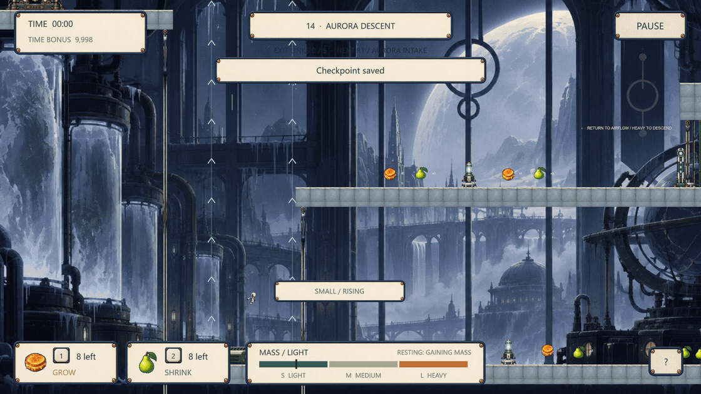
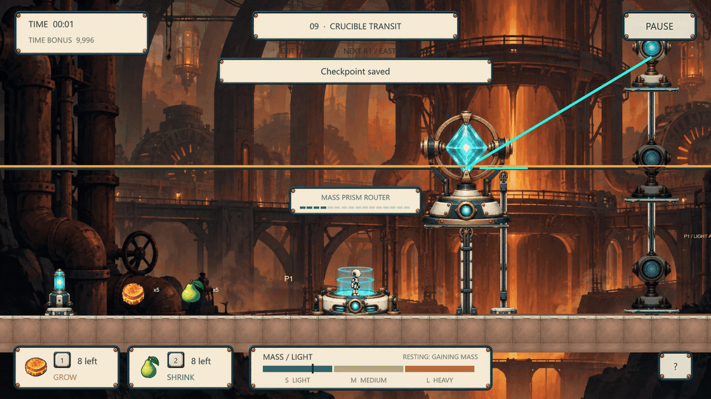
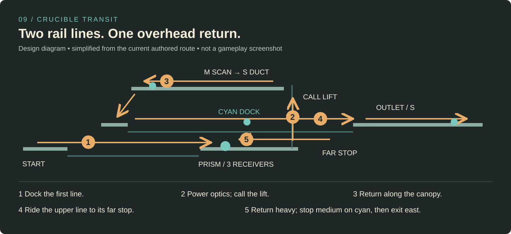
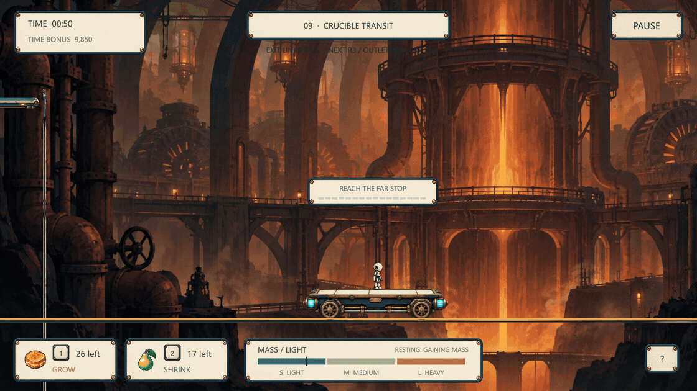
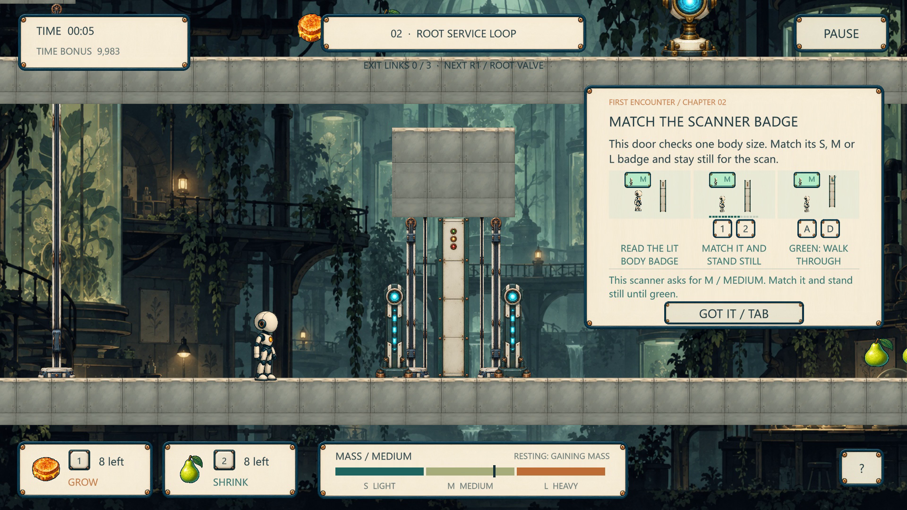

# Fit to Pass

**[Read the selected design portfolio · 8 pages](portfolio/Fit-to-Pass_Yibo-Wang_Selected.pdf)**

[Play the Windows demo](https://hajimi9914.itch.io/fit-to-pass) · [Watch gameplay & design · 4 min](https://www.youtube.com/watch?v=_GRWXU7BOKU) · [Explore the Unity source](Documentation/Code-guide.md)

You are a laboratory robot finding a way out. Eat to change body size, then use that body to fit through ducts, move machinery and choose a route through the facility. The challenge is deciding **which body you need next—and when to change it**.

**Yibo Wang — Game Design & Programming.** I designed all levels and gameplay systems: body rules, spatial puzzles, campaign progression, first-encounter guidance and retry flow.

**v2.4.0 · Unity 6000.5.9f1 · 15 chapters · Windows x64 · Single-player**

*Chapter 02, Root Service Loop. The food sits before the low service passage; the upper deck previews the route the player will return along. Click to watch the film.*

## One body, several kinds of decisions

Movement gradually sheds mass; standing still gains it. Grow and shrink food let the player intervene. Body size affects clearance, movement, jump height and how machines respond. **Medium is a useful control state:** it holds a mass lift, brakes a rail carriage and hovers in free airflow.

- **Greenhouse · 01–05:** establish size, low passages and pressure lifts; develop branching and return routes.
- **Foundry · 06–10:** heat makes resting gain mass faster and moving lose it more slowly. Plan timed crossings and powered transport.
- **Frozen Observatory · 11–15:** cold reverses that rhythm. Prepare spring landings, balance crossings and controlled airflow descents.

Each region has five consecutive chapters. The authored foundation maps open their respective regions; later chapters use different spatial structures and combine earlier lessons. [See every chapter and its design purpose →](Documentation/Level-design.md#campaign-progression)

## 01 · Open the path, then give up the weight

**Chapter 07 — Slag Return / timing, commitment and recovery**

The plate and blocking stone are visible together. A heavy body lowers the plate and raises the stone, but leaving the plate immediately starts the opposite motion. The player must trade the body that opens the route for the small, faster body that can cross it.

*Watch the plate on the left and the stone on the right: both reverse as soon as the robot steps off. The body change and successful crossing stay in one continuous take. Real-time playback; loop resets the demonstration.*

- **Design goal:** make changing size a decision under a visible, physical deadline.
- **Arrangement:** an overhead stone, a returning plate, supplies on the approach and a lower route back left.
- **Player judgement:** when is the opening high enough, and when should I stop holding it open and shrink?
- **Result shown:** the small robot clears the stone before it closes. A late attempt can retreat to reset the mechanism.

**A consequential revision:** an earlier implementation held the empty plate for eight seconds, leaving the stone suspended and weakening the need to hurry. I removed that delay. Medium still holds the current height while aboard; an empty plate now returns continuously. [Read the documented before/after and its evidence →](Documentation/Design-iteration.md#counterweight-a-missing-consequence)

## 02 · Change altitude, then choose the exit

**Chapter 14 — Aurora Descent / body size as flight control**

The route separates an ascent shaft from a free-flight shaft with a middle side port. In tiered airflow, size selects a high, middle or low landing. Free airflow has a different job: **small rises, medium holds the current height, heavy descends**.

*Follow the robot beside the left airflow rail. It rises small, changes to medium at the side port, then moves right onto the landing. This excerpt demonstrates recovery from below; the full route also asks for descent from above.*

The player reads the landing height before changing size. This turns food into trajectory control: remaining small overshoots the middle route; medium provides the pause needed to line up a horizontal exit. A lower recovery floor allows another approach instead of making a missed port a permanent dead end. [See the ascent → brake → descent route →](Documentation/Level-design.md#aurora-descent)

## 03 · Make the return route part of the puzzle

**Chapter 09 — Crucible Transit / dependencies, route memory and combined rules**

The lower rail cannot deliver the player to the upper outlet. Three optical receivers must first be charged using the three body sizes; their visible power link enables a freight lift. The upper service path then runs back left, through a medium scanner and a small duct, to reach a second transport line.

*First, watch the receiver lights fill. Then watch the heavy body call the now-powered lift and the small body board it. The cut removes travel between the prism and plate; each action is real-time gameplay.*

The second rail requires an outward journey **and** a return. Small moves right, heavy returns left, and medium stops on the cyan dock. Merely arriving at the far side does not complete the objective.

*Watch “REACH THE FAR STOP” change to the return instruction, then the medium brake complete the dock link. Travel between the two shown sections is cut. Stored docks and optical charges survive checkpoint retries.*

**Design intent:** revisit space with a new objective, rather than repeat the same corridor. **Implemented feedback:** beam receivers, the power cable, named route links and dock state tell the player what has changed and what remains. [Read the route breakdown and source connections →](Documentation/Level-design.md#crucible-transit)

## Teach the purpose; protect the retry

Early author walkthroughs exposed a recurring problem: seeing a device did not explain what it powered or why it mattered. The current first-encounter system links **purpose → illustrated action → destination**. Whole-level circuits receive an overview; individual devices explain themselves nearby, once, with enough reading time. Closed locks name the missing prerequisite.

*Chapter 02: the scanner and player remain visible beside the illustrated explanation. The card stays after the trigger is passed; acknowledgement is separate from completing the action.*

Retry placement checks body clearance, while completed route links, optics and required docks are restored with the checkpoint. Horizontal camera following uses a dead zone to avoid a forward lurch and rebound on stopping. [Design iteration and verification scope →](Documentation/Design-iteration.md)

## Design resources

- **[Selected design portfolio · 8-page PDF](portfolio/Fit-to-Pass_Yibo-Wang_Selected.pdf)** — body rules and all mechanism families, grouped by the decisions they create.
- **[Read the complete design case study · 10 pages](portfolio/Full-case-study.md)** — topic navigation, every page in order, full-size images and the final PDF.
- [Level design: three cases and the fifteen-chapter progression](Documentation/Level-design.md)
- [Source guide: follow a player decision into the implementation](Documentation/Code-guide.md)
- [Run the Unity project and controls](Documentation/Running-the-project.md)

## Source, credits and evidence

The current project is directly readable in [`Assets/Script`](Assets/Script); scenes live in [`Assets/Scenes`](Assets/Scenes), with twelve redesigned routes authored in [`RegionalRoutes.cs`](Assets/Script/RegionalRoutes.cs). Package versions and project settings are included. The original repository history is retained.

**Yibo Wang — Game Design & Programming. All levels and gameplay systems.**  
**Art & Music — AI-generated.** [Third-party resource and dependency notices](Documentation/Third-party-notices.md).

Gameplay excerpts are actual Unity recordings from the published film, rehearsed in isolated recording states. They are not generated gameplay or evidence of unaided player completion. Existing verification comprises author observation and scripted editor/input regressions; no external player-test results are claimed. [Media provenance](portfolio/media/Provenance.json) · [Release verification scope](Documentation/Release-2.4.0.json)
