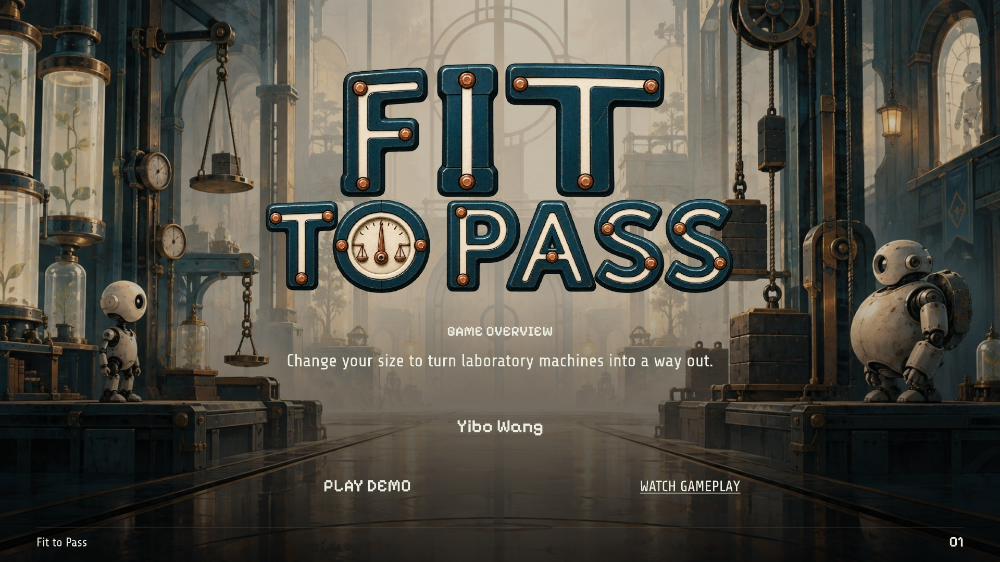
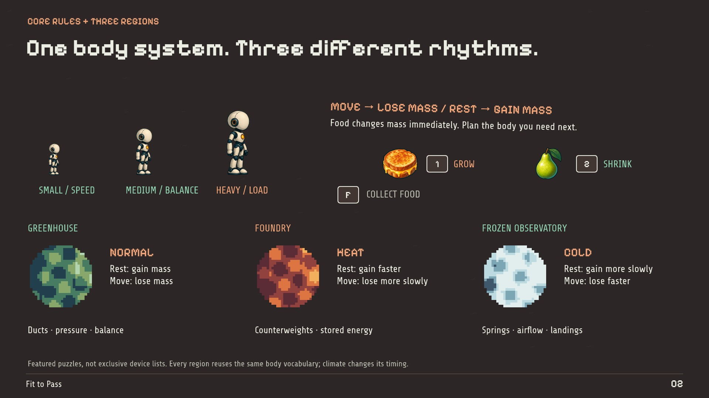
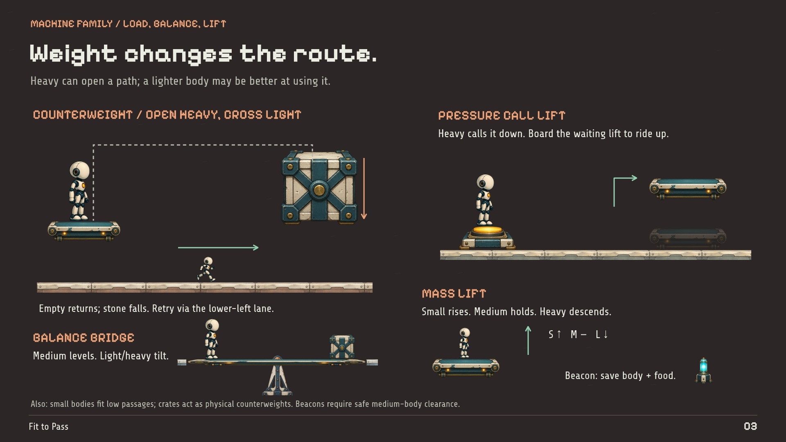
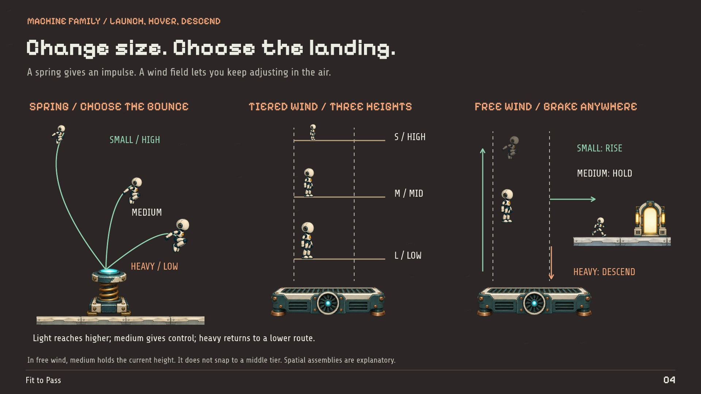
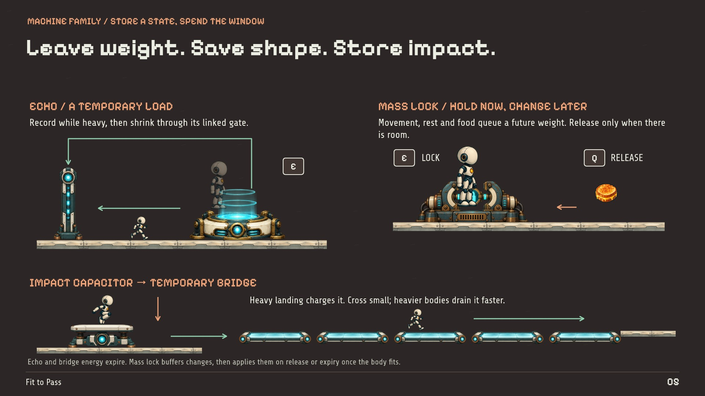
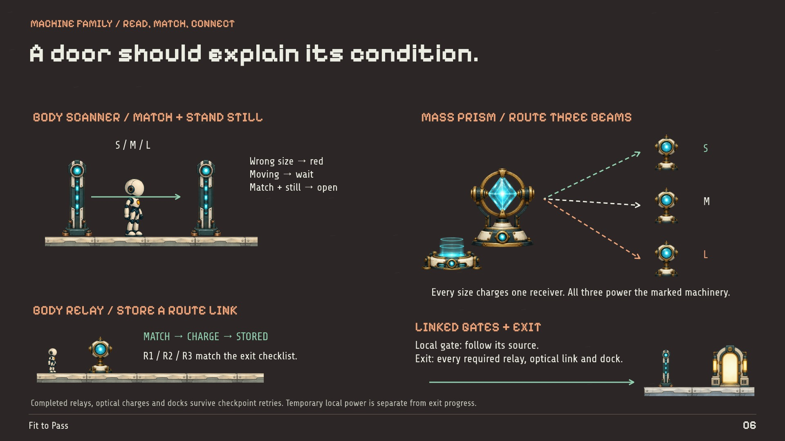
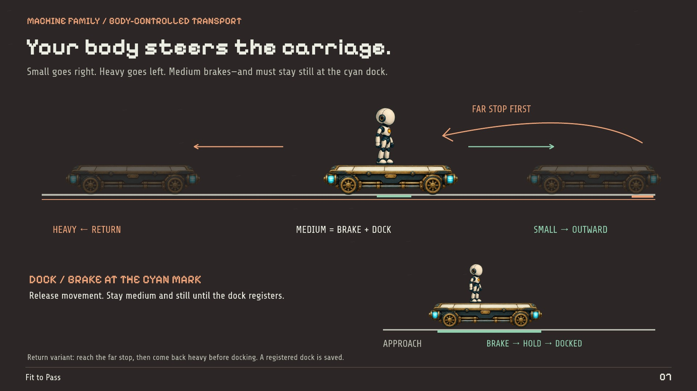
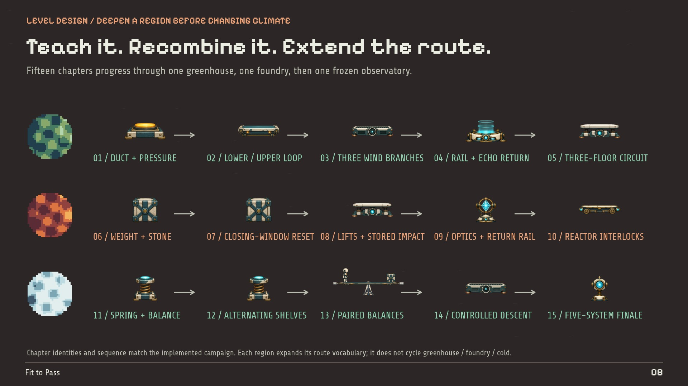
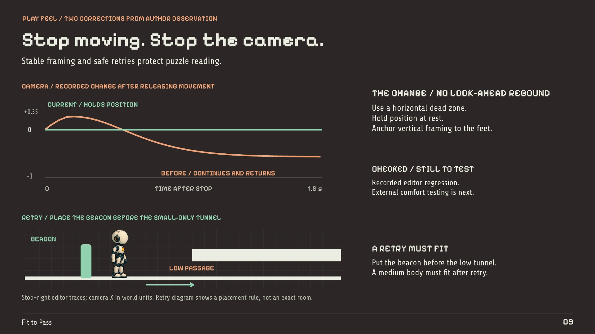
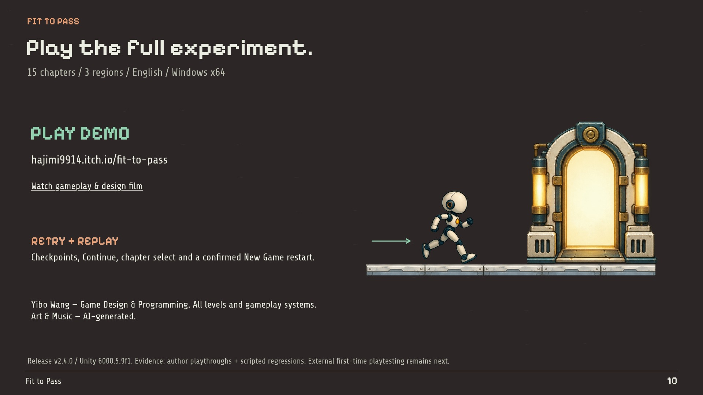

# Fit to Pass — Complete Design Case Study

Yibo Wang · Current final portfolio · 10 pages · 16:9 landscape

[Download the complete PDF](Fit-to-Pass_Yibo-Wang_Complete.pdf?raw=true) · [Selected portfolio · 8 pages](Fit-to-Pass_Yibo-Wang_Selected.pdf) · [Play](https://hajimi9914.itch.io/fit-to-pass) · [Watch](https://www.youtube.com/watch?v=_GRWXU7BOKU) · [Project home](../README.md)

The pages below are the approved design portfolio in its original order. Click any page to open the 1920-pixel image; download the PDF for selectable text, bookmarks and active links. Diagrams explain design; gameplay evidence is available on the [project homepage](../README.md#01--open-the-path-then-give-up-the-weight).

## Browse by topic

- [01 · Cover](#page-01)
- [02 · Body rules and regional rhythms](#page-02)
- [03 · Grounded mechanisms](#page-03)
- [04 · Springs and airflow](#page-04)
- [05 · Echo, mass lock and stored impact](#page-05)
- [06 · Scanners, optics and exit conditions](#page-06)
- [07 · Rail control and docking](#page-07)
- [08 · Regional campaign progression](#page-08)
- [09 · Camera comfort and safe retries](#page-09)
- [10 · Play, replay and credits](#page-10)

## 01 · Cover

[Topics](#browse-by-topic) · [Next](#page-02)

## 02 · Body rules and regional rhythms

[Previous](#page-01) · [Topics](#browse-by-topic) · [Next](#page-03)

## 03 · Grounded mechanisms

[Previous](#page-02) · [Topics](#browse-by-topic) · [Next](#page-04)

## 04 · Springs and airflow

[Previous](#page-03) · [Topics](#browse-by-topic) · [Next](#page-05)

## 05 · Echo, mass lock and stored impact

[Previous](#page-04) · [Topics](#browse-by-topic) · [Next](#page-06)

## 06 · Scanners, optics and exit conditions

[Previous](#page-05) · [Topics](#browse-by-topic) · [Next](#page-07)

## 07 · Rail control and docking

[Previous](#page-06) · [Topics](#browse-by-topic) · [Next](#page-08)

## 08 · Regional campaign progression

[Previous](#page-07) · [Topics](#browse-by-topic) · [Next](#page-09)

## 09 · Camera comfort and safe retries

[Previous](#page-08) · [Topics](#browse-by-topic) · [Next](#page-10)

## 10 · Play, replay and credits

[Previous](#page-09) · [Topics](#browse-by-topic) · [Download PDF](Fit-to-Pass_Yibo-Wang_Complete.pdf?raw=true)
